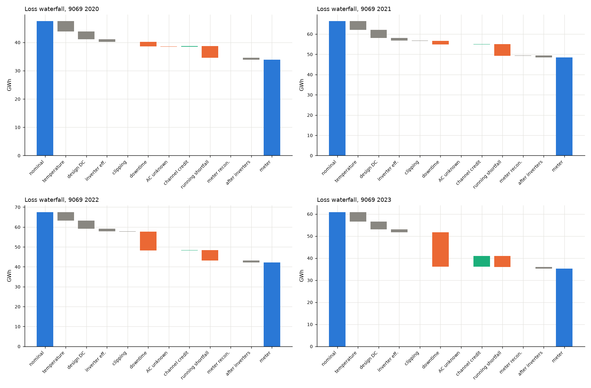
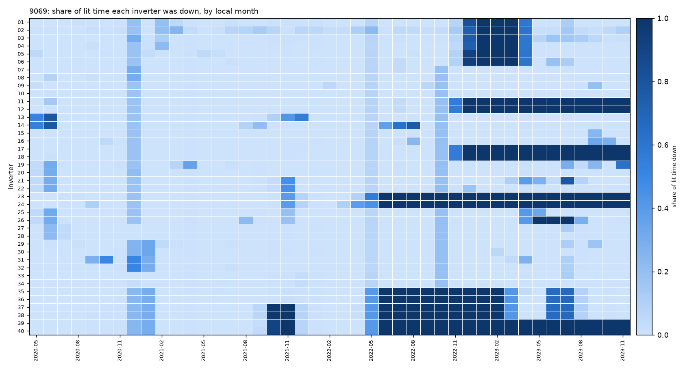
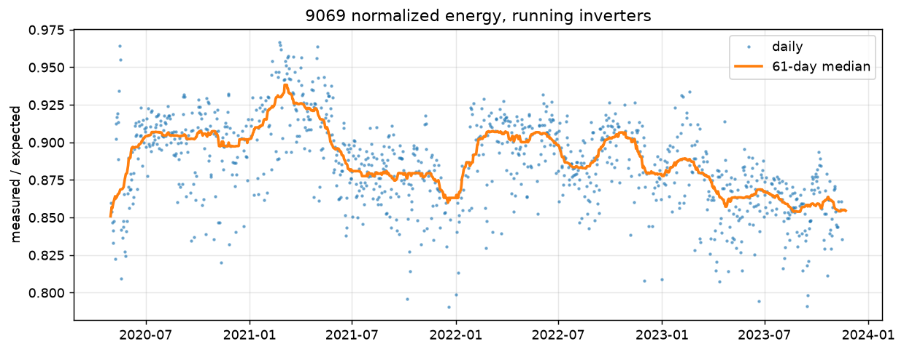
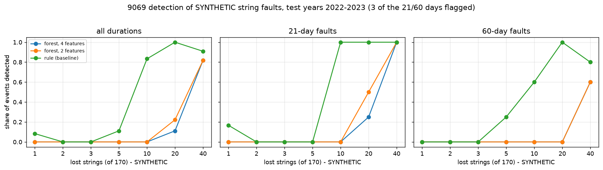

# PV Loss Auditor

[](https://github.com/owl-solar/pv-loss-auditor/actions/workflows/ci.yml)

**How much energy did a 38.7 MWp PV plant lose in 43 months, why, and what is it worth?**

An audit of a utility-scale plant from public measured data: actual generation against a weather-corrected
expectation, plant KPIs, and a loss waterfall in kWh and USD, followed by degradation and soiling analysis and
anomaly detection on the residuals. Everything is reproducible from public data and checked by unit tests.

<!-- Live dashboard: add the Streamlit Cloud URL here after deployment -->

## The result in one paragraph

Between May 2020 and November 2023 the plant (PVDAQ 9069, Simon Solar Farm, Georgia) delivered **159.6 GWh** to its
meter: 66 % of the nominal energy at the measured irradiance (242.2 GWh). Of the 82.6 GWh gap, 35.9 GWh is the plant
as built (temperature, assumed DC losses, inverter efficiency) and 3.4 GWh is lost after the inverters. The rest,
**43.2 GWh, is what an operator can act on: 23.4 GWh of downtime and 19.9 GWh of running shortfall, worth
1.31 M USD (0.91 ... 1.70 M)** at a projected price (see [how to read the USD figures](#how-to-read-the-usd-figures)).

| Cause | GWh | USD thousand (base) | USD thousand (band ±30 %) |
|---|---|---|---|
| Design (temperature, assumed DC losses, inverter efficiency, clipping) | 35.9 | 1085 | 759 ... 1410 |
| **Downtime**, net of data-channel loss | 23.4 | 705 | 494 ... 917 |
| **Running shortfall** (inverters that run, against the model) | 19.9 | 600 | 420 ... 780 |
| After inverters (transformer, cables) and meter reconciliation | 3.4 | 103 | 72 ... 134 |

The "design" block is the plant as built (and partly an assumption), not a recoverable loss.

Plant KPIs (temperature-corrected PR, variant C, T_ref = 41.5 °C; 2020 covers May-December, 2023 January-November):

| | 2020 | 2021 | 2022 | 2023 |
|---|---|---|---|---|
| PR at the plant meter, downtime included | 0.717 | 0.727 | 0.622 | 0.581 |
| PR of the inverters that run | 0.762 | 0.762 | 0.761 | 0.735 |
| Availability, energy-based, net of channel loss | 0.967 | 0.971 | 0.838 | 0.791 |
| Specific yield, kWh/kWp (partial years in 2020 and 2023) | 892 | 1276 | 1120 | 840 |



## What the audit found

**Downtime is the story of 2022-2023.** Net of data-channel loss it is 3.1 / 2.5 / 13.9 / 17.7 % of the nominal
energy in 2020 / 2021 / 2022 / 2023 (25.6 % in 2023 before the channel credit). 2020 covers May-December and 2023
January-November. Inverters do not fail alone: they fail in
groups (11+12+17+18, 23+24, 35+36, 37+38, 39+40; Jaccard 0.96-1.00). From 2022-05-23 to 2022-10-18 inverters 23, 24
and 35-40 stood still for 149 days, and the plant meter confirms it. A shared transformer skid or feeder is a
hypothesis; the files do not say.



**Not every zero is a stop.** In 2023 the sum of the inverter channels falls to 0.76-0.95 of the plant meter, so
part of the zeros are lost data channels, not downtime. A daily reconciliation against the meter credits
4.8 GWh back in 2023 (0.5 GWh in 2020-2022 together). It cannot say *which* inverter lies, so the correction is plant-level.
Availability, corrected this way: **0.967 / 0.971 / 0.838 / 0.791** (2023 quoted as 0.79; the raw 0.69 is a lower
bound). Temperature-corrected PR at the plant meter, including downtime: **0.717 / 0.727 / 0.622 / 0.581**; of the
inverters that run: 0.762 / 0.762 / 0.761 / 0.735.

**The inverters that run fall short of the model by 7.6-8.7 % of the plant's nominal energy.** Measured / expected
energy of the running inverters (median day) is 0.902 / 0.890 / 0.895 / 0.865. Where it goes, as a share of
expected energy: soiling about 1.4 % (RdTools SRR with rain as cleaning information), reflection (AOI) at most
3.0 % (an upper bound), and **5.4-9.6 % stays unexplained** in 2020-2022 (9.2-12.2 % in 2023). It mixes the error of
the assumed design losses, low-light behaviour, age and sensor bias, which the data cannot separate.
Year-on-year degradation is **about −1 %/yr ± 0.5 before 2023**, depending on the day filters; with 2023 it is
−1.55 ... −2.00 %/yr, which is a step, not ageing.



**Open-Meteo is not a substitute for on-site sensors.** ERA5 and ECMWF IFS (reanalysis, not satellite data) read
1.6-2.0 % above the reference cells at hours above 200 W/m², hourly nRMSE is 22 %, and their raw PR is 2-6 pp below
the cells, more than any year-to-year change. The 12-month ERA5 / cell ratio is flat (1.058 → 1.056): the cells did
not drift, and the 2023 step is not a sensor effect.

**Anomaly detection, tested on SYNTHETIC string faults.** Faults of 1-40 of 170 strings were injected into the real
AC series (seed 9069, 168 events), and detectors were tuned on 2020-2021 with a budget of at most 1 % false alarms
among clean inverter-days and reported on 2022-2023. A plain rule on the deviation from the inverter's own norm finds
**50 % of the events at precision 0.91**; an Isolation Forest finds 16-18 % at 0.57-0.59. The practical detection
limit is **about 10 strings (6 % of an inverter)**: of the 30 events with 1-5 strings, 2 were found. A single string
is 0.59 % of an inverter, below the noise of 0.68 %. Maximising F1 instead of budgeting false alarms gave 7-18 %
false alarms and was rejected.



### What I could not explain

- **The 2023 step.** Measured / expected of the running inverters is about 3 pp lower in 2023 than in 2020-2022. It
  is not soiling (the same value before 2023), not AOI (flat over the years), not a sensor effect, and downtime is
  excluded. It is common to the whole plant, so it vanishes by construction in a residual normalised by the peers.
  Failed strings or combiner boxes in the running inverters, or plant-level changes, are candidates, not conclusions.
- **The PR dip in November-December** (PR (C) 0.71-0.73). AOI does not explain it (the winter loss is only 0.3-0.5 pp
  above summer). What remains is row shading at low sun and low-light behaviour that linear PVWatts does not have.
- **A month of over-performance of inverter 30** (+0.09 ... +0.16 against its own norm, 2020-08-21 ... 09-21) right
  before the real event of 2020-09-22. The forest flags 20 days there (and only 1 inside the event); they count as
  false alarms because the event window in the config starts later. I kept the window as it is: it was found from the
  detector flags, so widening it afterwards would be circular. As a sensitivity check I re-ran the whole experiment with the
  window starting on 2020-08-21: the synthetic events are then drawn again (47 instead of 62 in the test years), the rule
  goes from 50 % at precision 0.91 to 53 % at 0.90, the forests from 16-18 % at 0.57-0.59 to 15 % at 0.65-0.74. So the
  rates above carry an uncertainty of a few percentage points from the choice of events alone. The 20 days are 0.1 % of
  the clean inverter-days, against a budget of 1 %.

## How to read the USD figures

The price is **30.19 USD/MWh, flat, band ±30 % (21.13 ... 39.25)**: Georgia Power's avoided energy cost for 2026,
"Solar Ground-Mounted Fixed Tilt", from the 2025 projections filed with the Georgia PSC (filing #223157, dockets 4822 /
16573). The plant is front-of-meter in Georgia, which has no ISO / RTO, so there are no nodal prices and no EIA
wholesale hub. Three limits go with every USD figure:

1. It is a **projection** for 2026 applied flat to 2020-2023; realised wholesale prices in 2021-2022 were higher.
2. It is the **utility's avoided cost, not this plant's PPA price** (unknown).
3. The ranking of the causes in kWh does not depend on the price; only the dollar value does.

Other limits: the expected-yield model is **not calibrated** and its 6.34 % design DC losses are an assumption (at
4 % / 8 % the running shortfall is 24.2 / 16.8 GWh instead of 19.9, downtime stays within 0.7 GWh); the waterfall
covers the 5-minute steps with daylight, irradiance, cell temperature and meter known (95.7-99.2 % of daylight steps
per year); the channel credit assumes an inverter-to-meter factor of 1.022 (1 pp of it moves the 2023 credit by about
0.35 GWh); and the anomaly results come from synthetic, abrupt, AC-side faults (62 test events in 14 cells).

## Limitations

- **The string faults are synthetic.** They are injected into the real AC series by an explicit, seeded script
  (`synthetic_faults.py`), abrupt, constant and AC-side, and are labelled SYNTHETIC in the code, the tests and the
  dashboard. The detection rates say how well the detectors find *such* faults, not how many real ones the plant had.
- **Open-Meteo is not on-site POA.** ERA5 and IFS read 1.6-2.0 % above the reference cells and their raw PR is
  2-6 pp lower; they are used as a cross-check (no cell drift), not as the irradiance of the audit.
- **The model is not calibrated** and the 6.34 % design DC losses are an assumption (see below).
- **The price is a projection**, not this plant's PPA price (see below).

## Data and plant

- **NREL PVDAQ** (Photovoltaic Data Acquisition), public OEDI S3 bucket `s3://oedi-data-lake/pvdaq/`, licence
  CC BY 4.0, DOI [10.25984/1846021](https://doi.org/10.25984/1846021).
- **Station 9069, Simon Solar Farm, Social Circle, GA:** fixed-tilt ground mount 20° / 180°, 38.7 MWp DC, 40 inverters
  of 825 kW (33 MW AC), 5-minute data. Chosen from a shortlist of five stations
  ([`reports/station_candidates.md`](reports/station_candidates.md)).
- **Analysis period 2020-05 ... 2023-11** (43 months), chosen from a coverage map of 2016-2023
  (`reports/figures/9069_data_coverage.png`). A longer candidate period was rejected: the thermocouples work on 0-57 %
  of the time before 2020-05 and the meter file has a gap of 357 days.
- **Open-Meteo** historical weather (ERA5, ECMWF IFS, archive API with explicit `models=`) as a reanalysis alternative
  to on-site sensors. The satellite API has no coverage at this site; a true satellite source would be NSRDB or
  NASA POWER.
- **Electricity price:** see above (`src/pv_loss_auditor/prices.py`).

### What the QA found

The data were not taken at face value ([`notebooks/01_data_qa.ipynb`](notebooks/01_data_qa.ipynb),
[`reports/9069_qa_report.md`](reports/9069_qa_report.md)):

- **The files use different clocks.** Irradiance and environment switch daylight saving time on EU dates, inverter and
  meter files on US dates. Without a conversion per file, power is shifted by 1 h against irradiance for about three
  weeks a year (`reports/figures/9069_clock_offset.png`). The acceptance test: the lag between AC power and the
  reference cell goes from +1.0 h to 0.0 h in every window where the rules differ.
- **The NREL flag "Wrong mounting config" is not supported:** fixed 20° / 180° fits the measured POA with nRMSE 4.9 %,
  a single-axis tracker with 36 % (`reports/figures/9069_geometry_check.png`).
- **The string metadata contradicts the data** (272 vs 68 strings per inverter against equal clear-day energy of all
  inverters); 170 strings per inverter is derived from the DC power instead.
- One thermocouple reads implausible values for the whole period (45-80 °C at night) and is excluded; several
  inverters have frozen readings on 28-82 days. Everything is flagged, nothing is deleted.

## Method

- **Expected generation** ([`src/pv_loss_auditor/model.py`](src/pv_loss_auditor/model.py)): pvlib PVWatts DC and inverter functions called one by one
  (not ModelChain), so every step is visible. POA = mean of two reference cells; cell temperature = mean of three
  back-of-module thermocouples + 3 °C × G/1000; γ = −0.416 %/°C (DC-weighted nameplate); 6.34 % design DC losses;
  inverter η 0.98, clipped at 825 kW.
- **KPIs** ([`src/pv_loss_auditor/kpi.py`](src/pv_loss_auditor/kpi.py)): Performance Ratio per IEC 61724-1 at inverter-step level (ratio of sums) in
  three temperature treatments (raw, 25 °C, the POA-weighted mean cell temperature of the period), specific yield,
  availability (time- and energy-based).
- **Loss waterfall** ([`src/pv_loss_auditor/losses.py`](src/pv_loss_auditor/losses.py)): a sequential cascade in physical order, each step the
  difference of two neighbouring cumulative quantities, so the steps add up to nominal − metered by construction; a
  closure check stops the run otherwise. Downtime is separated from data-channel loss by a daily reconciliation of
  the inverter sum against the plant meter.
- **Degradation and soiling** ([`src/pv_loss_auditor/degradation.py`](src/pv_loss_auditor/degradation.py)): RdTools year-on-year degradation and SRR
  soiling on the daily ratio of measured to expected energy of the running inverters.
- **Anomaly detection** ([`src/pv_loss_auditor/anomalies.py`](src/pv_loss_auditor/anomalies.py), [`src/pv_loss_auditor/synthetic_faults.py`](src/pv_loss_auditor/synthetic_faults.py)):
  residual = measured / expected per inverter divided by the median of its running peers; features as deviations
  from the inverter's own 121-day norm; Isolation Forest and a plain rule; synthetic string faults from an explicit,
  documented, seeded script and labelled synthetic everywhere.

## Dashboard

A Streamlit app reads small tables exported from the same code ([`src/pv_loss_auditor/export_dashboard.py`](src/pv_loss_auditor/export_dashboard.py),
`app/data/`, about 350 kB), so it needs neither the raw data nor the model. Pages:

1. **Summary:** headline loss, KPIs, losses by cause and year (GWh, USD or % of nominal energy), price slider.
2. **Loss waterfall:** the cascade for any year, sensitivity to the assumed design losses, losses by month.
3. **Downtime and outages:** state map of the 40 inverters, episodes checked against the meter, failure groups.
4. **Degradation and soiling:** normalized energy, year-on-year rates over a grid of filters, soiling, Open-Meteo
   comparison, split of the shortfall, and the open questions.
5. **Anomaly detection:** detection rate against fault size, why a false-alarm budget, real events. Marked SYNTHETIC.
6. **Methodology:** definitions, assumptions that are mine, what the numbers do not say.

```powershell
streamlit run app/Home.py
```

## Quick start

No data download is needed to run the tests: a 14-day slice of the real clean dataset (353 kB, containing the
plant-wide stop of 12-18 December 2020) lives in `tests/fixtures/`.
```powershell
py -3.13 -m venv .venv; .\.venv\Scripts\Activate.ps1      # Linux / macOS: python3.13 -m venv .venv && source .venv/bin/activate
pip install -e ".[data,dev]"                               # the package with its pinned dependencies and test tools
pytest                                                     # 160 tests, about 20 s
python -m scripts.compare_golden --run fixture             # re-run the pipeline on the fixture, compare with the golden values
```
The dashboard (`pip install -e ".[app]"`, then `streamlit run app/Home.py`) reads the small exported tables in
`app/data/`, so it runs without the raw data as well.

## How to reproduce the full audit

Windows PowerShell, Python 3.13:
```powershell
py -3.13 -m venv .venv
.\.venv\Scripts\Activate.ps1
python -m pip install --upgrade pip
pip install -r requirements.txt
```
Download the analysis period of PVDAQ system 9069 (public OEDI S3 bucket, no credentials; about 1.2 GB, resumes month
by month after an interruption), then build the clean dataset:
```powershell
python -m pv_loss_auditor.pvdaq --config configs/system_9069.yaml --period --dry-run   # size estimate only
python -m pv_loss_auditor.pvdaq --config configs/system_9069.yaml --period
python -m pv_loss_auditor.data --config configs/system_9069.yaml                       # -> data/processed/9069/
```
The price file (Georgia PSC filing #223157, 249 kB) goes to `data/raw/prices/` (see `price:` in the config).
Then run the notebooks in order (`01_data_qa` ... `05_anomaly_detection`), and export the dashboard tables:
```powershell
python -m pv_loss_auditor.export_dashboard --config configs/system_9069.yaml            # -> app/data/ (about 1.5 minutes)
```
Tests (synthetic data only, no download needed):
```powershell
python -m pytest
```
The full-period golden values (below) are checked with `python -m scripts.compare_golden --run full`, which needs
the processed data and the cached Open-Meteo files (about 1 minute).

## Testing & CI

- **160 tests, about 20 s, no network.** Physics tests with a known answer (PR = 0.85 for 1000 kWh/m² on 100 kW giving
  85 000 kWh; night hours are not downtime; no clipping at DC/AC = 1.0 below the rating), a waterfall that must close
  for arbitrary data, `ValueError` on nonsensical inputs, and an end-to-end run on the real 14-day fixture
  against the golden values. A string fault injected into that fixture must be found by the rule and the forest.
  Coverage of `kpi.py` is 100 %, `losses.py` 99 %, `model.py` 100 % (the download code is not testable offline).
- **GitHub Actions** ([`.github/workflows/ci.yml`](.github/workflows/ci.yml)) on every push and pull request,
  Python 3.13: `ruff check`, `ruff format --check`, `mypy` (every function in the package is annotated), `pytest --cov`, and a coverage floor of 95 % for the KPI, loss and
  model modules. CI uses only the fixtures in the repository and never downloads data.
- **Before each commit** (pre-commit, see `.pre-commit-config.yaml`): `ruff check --fix`, `ruff format` and `mypy`.
- All dependencies are pinned in [`pyproject.toml`](pyproject.toml); randomness is seeded (Isolation Forest, the fault
  generator and the RdTools bootstrap), so two runs give identical numbers.

## How I verified AI-generated code

The code was written with an AI assistant, so every change was checked against something other than the assistant.
- **Golden values before and after the refactor.** Before moving any logic I froze 2367 numbers (KPIs, every waterfall
  step, degradation, soiling, detector results, outage counts) in `tests/fixtures/golden_values.json`: 127 on the
  14-day fixture and 2240 on the full period. After the refactor (new package, validation, logging, type hints,
  formatting) the same code produced the same numbers: 0 differences at a relative tolerance of 1e-9, and the 25
  tables of the dashboard were identical. The file changes only on purpose, with the reason in the commit message.
- **Physics tests with answers worked out by hand,** not copied from the program's output (see above).
- **A second source for the formulas:** pvlib's inverter function is compared with my unclipped copy below the
  rating; PR, availability and the waterfall balance are written in the docstrings next to the code.
- **Manual review of the formulas and decisions.** Every methodological choice (PR definition, filter thresholds,
  clipping vs downtime, price) was proposed with options and decided by me; numbers in the captions of the dashboard are
  computed from the tables, not typed, after several typed ones turned out wrong.
- **Type checking found a real bug in my own refactor:** converting `print(..., flush=True)` to `log.info(..., flush=True)` is
  invalid (Logger has no `flush`); it would have crashed the download at the first retry. `mypy` flagged it; a test now checks
  every logging call of the package.
- **Findings from the tests that were not obvious:** the stuck-sensor test of pvanalytics does not flag the first value
  of a frozen run; zip() truncation in several places is deliberate and documented in the lint configuration.

## Repository structure
```
configs/           # system_<id>.yaml: all parameters (thresholds, prices, contamination, periods)
src/pv_loss_auditor/  # data (QA, cleaning), model, kpi, losses, anomalies, degradation, outages, prices, ...
tests/             # physics tests, tests/fixtures/ (14 real days, golden_values.json)
scripts/           # make_fixture.py, capture_golden.py, compare_golden.py
notebooks/         # one analysis notebook per phase (they import the package)
app/               # Streamlit dashboard (app/data/ holds the exported tables)
.github/workflows/ # CI
data/raw/, data/processed/   # downloaded and cleaned data (not committed)
reports/figures/   # figures used in this README
```

## Project status
- [x] Phase 0: repo skeleton, environment
- [x] Phase 1: data selection and QA
- [x] Phase 2: expected yield model and KPIs
- [x] Phase 3: loss waterfall (kWh and USD)
- [x] Phase 4: degradation and soiling (RdTools); on-site sensor vs Open-Meteo
- [x] Phase 5: anomaly detection on residuals; synthetic string faults
- [x] Phase 6: Streamlit dashboard; case-study write-up

Next in the chain: **Repowering Planner** (NPV / IRR / LCOE of repowering scenarios, using the outputs of this audit)
and **O&M Copilot** (a RAG assistant for alarm codes and manuals).

## How this project was built
Developed with AI assistance (Claude Code). I defined the methodology, station selection criteria and decision thresholds, reviewed all changes, and investigated data issues; the AI accelerated implementation.
